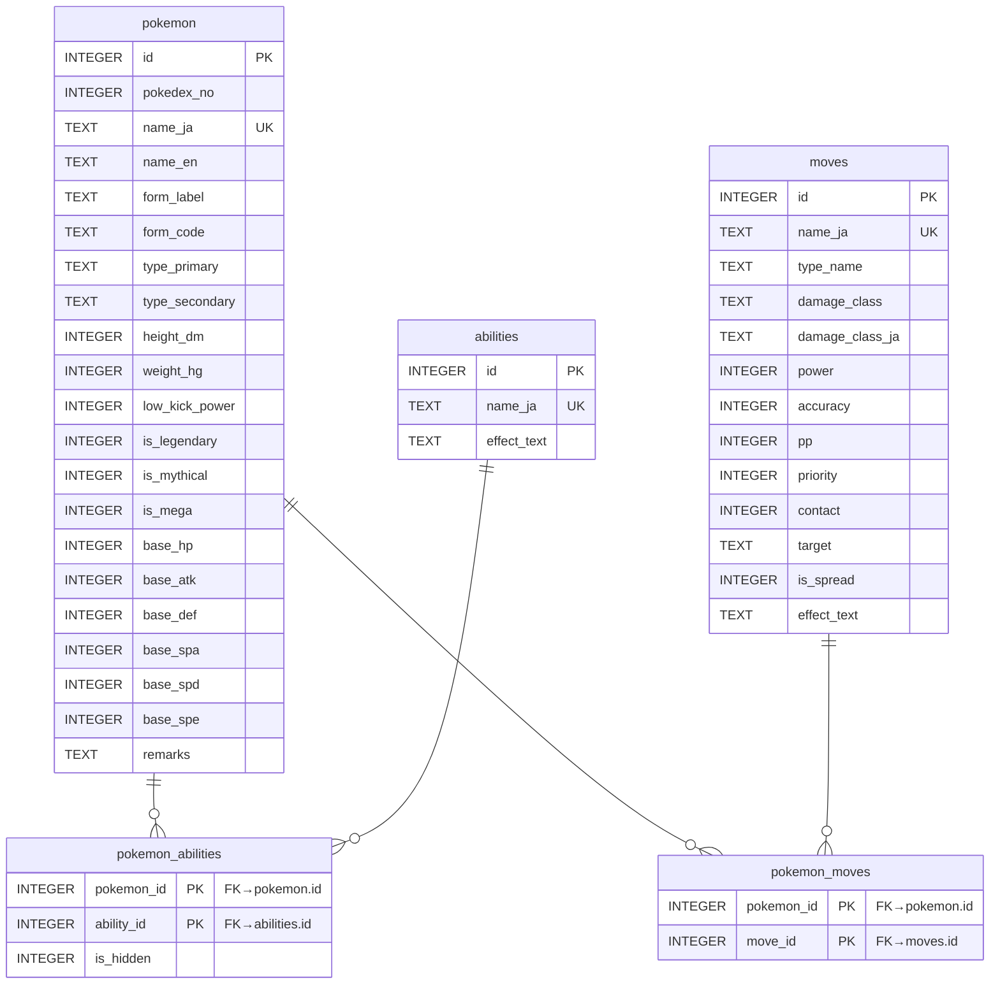

# ポケモンマスターデータベースのスキーマ

各ポケモンや技のマスター情報は、Cloudflare D1（SQLite）のデータベース `pokemon-master` に格納している。このドキュメントは、そのデータベース設計についてまとめてある。

このスキーマに基づき、ユーザーからのリクエストに最適な検索を行うこと。

## 1. 参照方法

- Cloudflare Workers 上の MCP サーバ `pokemon-master`（`cloudflare/`）経由で参照する。
  - `describe_schema`: テーブル定義・カラムの意味・件数・クエリ例を返す。
  - `query`: 読み取り専用の SQL（SELECT / WITH / VALUES の 1 文）を実行し、結果を JSON で返す（最大 1000 行）。
- SQLite なのでスキーマ名は付けない（`champions.pokemon` ではなく `pokemon`）。
- 真偽値は `0` / `1` の整数で保持する（例: `is_mega = 1`）。

## 2. 想定要件とユースケース

- MCP サーバーからの検索を想定し、特定の技を覚えるポケモンや素早さなどの種族値条件を高速に判定できること。
- **バージョン管理**: D1 にはスキーマ機能が無いため、将来ゲームのバージョンが変わる場合はバージョンごとに別の D1 データベースを作って分離する。現在は Champions 用の `pokemon-master` のみ。
- スキーマ定義は `cloudflare/migrations/` で管理する（Supabase 時代の `champions` スキーマ最終形を移植したもの。旧 `supabase/` ディレクトリは Supabase 廃止に伴い削除済みで、git 履歴から参照できる）。

## 3. モデリング方針

- **ポケモン単位の管理**: フォルム分岐は別レコードとして `pokemon` テーブルに格納し、フォーム専用テーブルを廃止。
- **タイプ・種族値は直接カラム化**: タイプは全 18 種類で固定のため列を持たせ、チェック制約で妥当性を担保する。種族値も固定 6 項目を個別カラムで保持する。
- **リレーションの最小化**: 技・特性は参照テーブルを残しつつ、学習経路やアイテム系テーブルは削除。ポケモンと技の関係は 1 つの中間テーブルで表現する。
- **日本語名称を基準**: 多言語展開は想定せず、日本語名称を主要キーに補助的に利用できるようにする。

## 4. テーブル定義

> **注**: 型は SQLite のもの。真偽値は `INTEGER`（0/1、チェック制約付き）で保持する。中間テーブル 2 つは `WITHOUT ROWID`。

### ER図

### 4.1 `pokemon`

| カラム名 | 型 | 制約 | 説明 |
| --- | --- | --- | --- |
| `id` | INTEGER | PK | 内部 ID |
| `pokedex_no` | INTEGER | NOT NULL | 全国図鑑番号（フォーム違いは同一番号可） |
| `name_ja` | TEXT | UNIQUE NOT NULL | ポケモン名（フォーム名込み） |
| `name_en` | TEXT |  | ポケモン英語名（フォーム名込み） |
| `form_label` | TEXT |  | フォーム名だけを保持（例: 「(ヒスイ)」） |
| `form_code` | TEXT |  | 詳細ページURL上のフォーム識別コード（例: `m`, `x`, `y`, `a`, `h`） |
| `type_primary` | TEXT | NOT NULL | タイプ 1（チェック制約で 18 種類に限定） |
| `type_secondary` | TEXT |  | タイプ 2 |
| `height_dm` | INTEGER |  | 高さ（デシメートル） |
| `weight_hg` | INTEGER |  | 重さ（ヘクトグラム） |
| `low_kick_power` | INTEGER |  | 「けたぐり」「くさむすび」威力換算値 |
| `is_legendary` | INTEGER | DEFAULT 0 | 伝説フラグ |
| `is_mythical` | INTEGER | DEFAULT 0 | 幻フラグ |
| `is_mega` | INTEGER | DEFAULT 0 | メガ進化フラグ |
| `base_hp` | INTEGER | NOT NULL | 種族値: HP |
| `base_atk` | INTEGER | NOT NULL | 種族値: 攻撃 |
| `base_def` | INTEGER | NOT NULL | 種族値: 防御 |
| `base_spa` | INTEGER | NOT NULL | 種族値: 特攻 |
| `base_spd` | INTEGER | NOT NULL | 種族値: 特防 |
| `base_spe` | INTEGER | NOT NULL | 種族値: 素早さ |
| `remarks` | TEXT |  | 備考（例: 入手条件メモ） |

> チェック制約例: `type_primary` と `type_secondary` は `('ノーマル', 'ほのお', ..., 'フェアリー')` に限定しつつ、NULL を許容する。

### 4.2 `abilities`

| カラム名 | 型 | 制約 | 説明 |
| --- | --- | --- | --- |
| `id` | INTEGER | PK | 内部 ID |
| `name_ja` | TEXT | UNIQUE NOT NULL | 特性名 |
| `effect_text` | TEXT |  | 効果説明（日本語） |

### 4.3 `pokemon_abilities`

| カラム名 | 型 | 制約 | 説明 |
| --- | --- | --- | --- |
| `pokemon_id` | INTEGER | PK, FK→`pokemon.id` | ポケモン |
| `ability_id` | INTEGER | PK, FK→`abilities.id` | 特性 |
| `is_hidden` | INTEGER | NOT NULL DEFAULT 0 | 夢特性であれば `1` |

### 4.4 `moves`

| カラム名 | 型 | 制約 | 説明 |
| --- | --- | --- | --- |
| `id` | INTEGER | PK | 内部 ID |
| `name_ja` | TEXT | UNIQUE NOT NULL | 技名 |
| `type_name` | TEXT | NOT NULL | 技タイプ（18 種類でチェック制約） |
| `damage_class` | TEXT |  | `physical` / `special` / `status`（NULL許容） |
| `damage_class_ja` | TEXT |  | 技分類の日本語表記（`物理` / `特殊` / `変化` / `-`） |
| `power` | INTEGER |  | 威力 |
| `accuracy` | INTEGER |  | 命中率 |
| `pp` | INTEGER |  | 技ポイント |
| `priority` | INTEGER | DEFAULT 0 | 優先度 |
| `contact` | INTEGER |  | 接触技であれば `1`、非接触技であれば `0` |
| `target` | TEXT | DEFAULT `'single'` | 技の対象。`single`（相手１体）/ `all_opponents`（相手全体）/ `all_except_self`（自分以外全員）/ `self`（自分自身） |
| `is_spread` | INTEGER | DEFAULT 0 | 全体技補正（×3/4）対象なら `1`（`all_opponents` / `all_except_self`） |
| `effect_text` | TEXT |  | 効果説明 |

### 4.5 `pokemon_moves`

| カラム名 | 型 | 制約 | 説明 |
| --- | --- | --- | --- |
| `pokemon_id` | INTEGER | PK, FK→`pokemon.id` | ポケモン |
| `move_id` | INTEGER | PK, FK→`moves.id` | 技 |

> 学習手段の区別は保有しない。ポケモンと技の関連のみを管理する。

## 5. インデックス設計

### 5.1 `pokemon` テーブルのインデックス

| インデックス名 | 対象カラム | 種類 | 目的 |
| --- | --- | --- | --- |
| `pokemon_pkey` | `id` | PK | 主キー（自動作成） |
| `pokemon_name_ja_key` | `name_ja` | UNIQUE | ポケモン名の一意性保証（自動作成） |
| `idx_pokemon_pokedex_no` | `pokedex_no` | B-tree | 図鑑番号での検索 |
| `idx_pokemon_base_spe` | `base_spe` | B-tree | 素早さ種族値での範囲検索（例: `base_spe >= 102`） |
| `idx_pokemon_is_legendary` | `is_legendary` | B-tree | 伝説ポケモンフィルタ |
| `idx_pokemon_is_mythical` | `is_mythical` | B-tree | 幻ポケモンフィルタ |
| `idx_pokemon_is_mega` | `is_mega` | B-tree | メガ進化ポケモンフィルタ |
| `idx_pokemon_type_normal` | 部分インデックス | B-tree | ノーマルタイプ検索（`type_primary = 'ノーマル' OR type_secondary = 'ノーマル'`） |
| `idx_pokemon_type_fire` | 部分インデックス | B-tree | ほのおタイプ検索（`type_primary = 'ほのお' OR type_secondary = 'ほのお'`） |
| `idx_pokemon_type_water` | 部分インデックス | B-tree | みずタイプ検索（`type_primary = 'みず' OR type_secondary = 'みず'`） |
| `idx_pokemon_type_electric` | 部分インデックス | B-tree | でんきタイプ検索（`type_primary = 'でんき' OR type_secondary = 'でんき'`） |
| `idx_pokemon_type_grass` | 部分インデックス | B-tree | くさタイプ検索（`type_primary = 'くさ' OR type_secondary = 'くさ'`） |
| `idx_pokemon_type_ice` | 部分インデックス | B-tree | こおりタイプ検索（`type_primary = 'こおり' OR type_secondary = 'こおり'`） |
| `idx_pokemon_type_fighting` | 部分インデックス | B-tree | かくとうタイプ検索（`type_primary = 'かくとう' OR type_secondary = 'かくとう'`） |
| `idx_pokemon_type_poison` | 部分インデックス | B-tree | どくタイプ検索（`type_primary = 'どく' OR type_secondary = 'どく'`） |
| `idx_pokemon_type_ground` | 部分インデックス | B-tree | じめんタイプ検索（`type_primary = 'じめん' OR type_secondary = 'じめん'`） |
| `idx_pokemon_type_flying` | 部分インデックス | B-tree | ひこうタイプ検索（`type_primary = 'ひこう' OR type_secondary = 'ひこう'`） |
| `idx_pokemon_type_psychic` | 部分インデックス | B-tree | エスパータイプ検索（`type_primary = 'エスパー' OR type_secondary = 'エスパー'`） |
| `idx_pokemon_type_bug` | 部分インデックス | B-tree | むしタイプ検索（`type_primary = 'むし' OR type_secondary = 'むし'`） |
| `idx_pokemon_type_rock` | 部分インデックス | B-tree | いわタイプ検索（`type_primary = 'いわ' OR type_secondary = 'いわ'`） |
| `idx_pokemon_type_ghost` | 部分インデックス | B-tree | ゴーストタイプ検索（`type_primary = 'ゴースト' OR type_secondary = 'ゴースト'`） |
| `idx_pokemon_type_dragon` | 部分インデックス | B-tree | ドラゴンタイプ検索（`type_primary = 'ドラゴン' OR type_secondary = 'ドラゴン'`） |
| `idx_pokemon_type_dark` | 部分インデックス | B-tree | あくタイプ検索（`type_primary = 'あく' OR type_secondary = 'あく'`） |
| `idx_pokemon_type_steel` | 部分インデックス | B-tree | はがねタイプ検索（`type_primary = 'はがね' OR type_secondary = 'はがね'`） |
| `idx_pokemon_type_fairy` | 部分インデックス | B-tree | フェアリータイプ検索（`type_primary = 'フェアリー' OR type_secondary = 'フェアリー'`） |

> **部分インデックスについて**: タイプ検索は `type_primary` と `type_secondary` のどちらかに該当タイプが含まれるかを判定する必要があるため、各タイプごとに部分インデックスを作成。これにより、「ほのおタイプのポケモン」のような検索が高速化される。

### 5.2 `abilities` テーブルのインデックス

| インデックス名 | 対象カラム | 種類 | 目的 |
| --- | --- | --- | --- |
| `abilities_pkey` | `id` | PK | 主キー（自動作成） |
| `abilities_name_ja_key` | `name_ja` | UNIQUE | 特性名の一意性保証（自動作成） |

### 5.3 `pokemon_abilities` テーブルのインデックス

| インデックス名 | 対象カラム | 種類 | 目的 |
| --- | --- | --- | --- |
| `pokemon_abilities_pkey` | `(pokemon_id, ability_id)` | PK | 主キー（自動作成） |
| `idx_pokemon_abilities_ability_id` | `(ability_id, pokemon_id)` | B-tree | 特性からポケモンを逆引き検索 |
| `idx_pokemon_abilities_is_hidden` | `is_hidden` | B-tree | 夢特性フィルタ |

### 5.4 `moves` テーブルのインデックス

| インデックス名 | 対象カラム | 種類 | 目的 |
| --- | --- | --- | --- |
| `moves_pkey` | `id` | PK | 主キー（自動作成） |
| `moves_name_ja_key` | `name_ja` | UNIQUE | 技名の一意性保証（自動作成） |
| `idx_moves_type_name` | `type_name` | B-tree | 技タイプでの絞り込み |
| `idx_moves_damage_class` | `damage_class` | B-tree | 物理/特殊/変化での絞り込み |

### 5.5 `pokemon_moves` テーブルのインデックス

| インデックス名 | 対象カラム | 種類 | 目的 |
| --- | --- | --- | --- |
| `pokemon_moves_pkey` | `(pokemon_id, move_id)` | PK | 主キー（自動作成） |
| `idx_pokemon_moves_move_id` | `(move_id, pokemon_id)` | B-tree | 特定技を覚えるポケモン検索（逆引き） |

## 6. 対戦環境（統計情報）テーブル

Pokemon Champions の使用率統計を保持する。定義は `cloudflare/migrations/0002_battle_data.sql`、データは `update-battle-data` スキルがサイトから取得して直接投入する（日々変わるためリポジトリでは管理しない）。最新シーズン・ルールのみを保持し、更新時は全件入れ替える。参照方法は `battle-data` スキルを参照。

| テーブル | 主キー | 内容 |
| --- | --- | --- |
| `battle_seasons` | `(season, rule)` | 対象シーズン名・ルール名・期間・更新日時・ソースURL |
| `battle_rankings` | `(season, rule, rank)` | ランキング全件。`pokemon_name`（サイト表記、`(season, rule)` 内で一意）、`pokemon_id`（FK→`pokemon.id`）、`has_detail`（詳細があれば `1`） |
| `battle_usages` | `(season, rule, pokemon_name, category, rank)` | 上位50匹の採用率。`category` は `move` / `ability` / `item` / `nature` / `stat_spread`、`name`、`detail`（性格の上昇下降など）、`rate`（%） |
